<p align="center">
  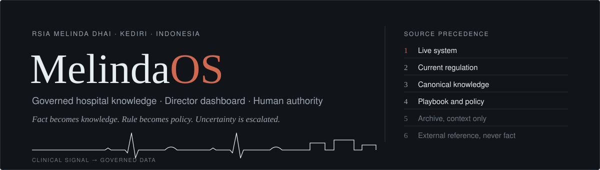
</p>

<p align="center">
  <b>Institutional intelligence for RSIA Melinda DHAI Kediri.</b><br />
  <sub>AI may structure the knowledge. Authority never moves to the AI.</sub>
</p>

<p align="center">
  <a href="#01--telemetry">01 Telemetry</a> ·
  <a href="#02--system-map">02 Map</a> ·
  <a href="#03--truth-engine">03 Truth</a> ·
  <a href="#04--knowledge-pipeline">04 Pipeline</a> ·
  <a href="#06--request-path">06 Request</a> ·
  <a href="#09--runtime">09 Runtime</a> ·
  <a href="#12--verify">12 Verify</a> ·
  <a href="#14--index">14 Index</a>
</p>

## 01 · Telemetry

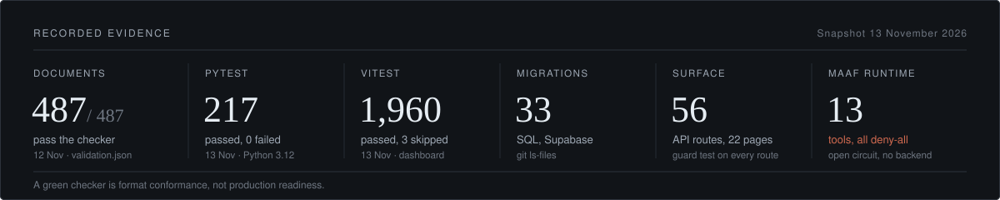

> [!WARNING]
> **Green documents do not mean a green runtime.** The checker measures format and governance, not clinical accuracy or freshness. This README does not claim production readiness.

## 02 · System map

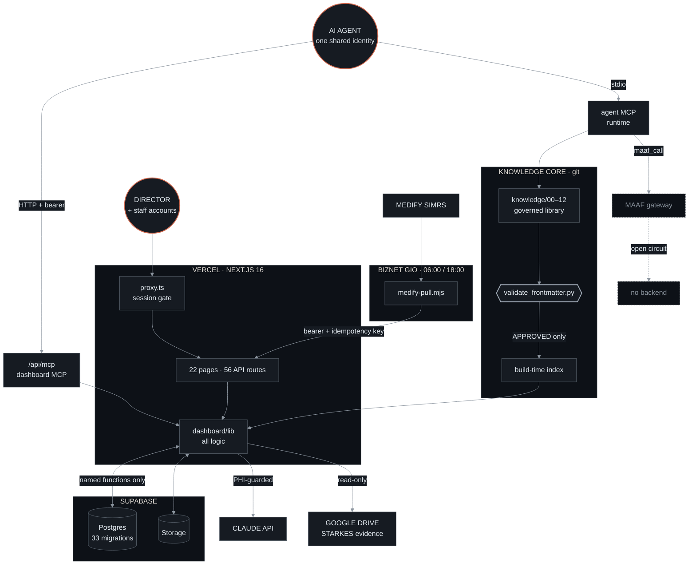

## 03 · Truth engine

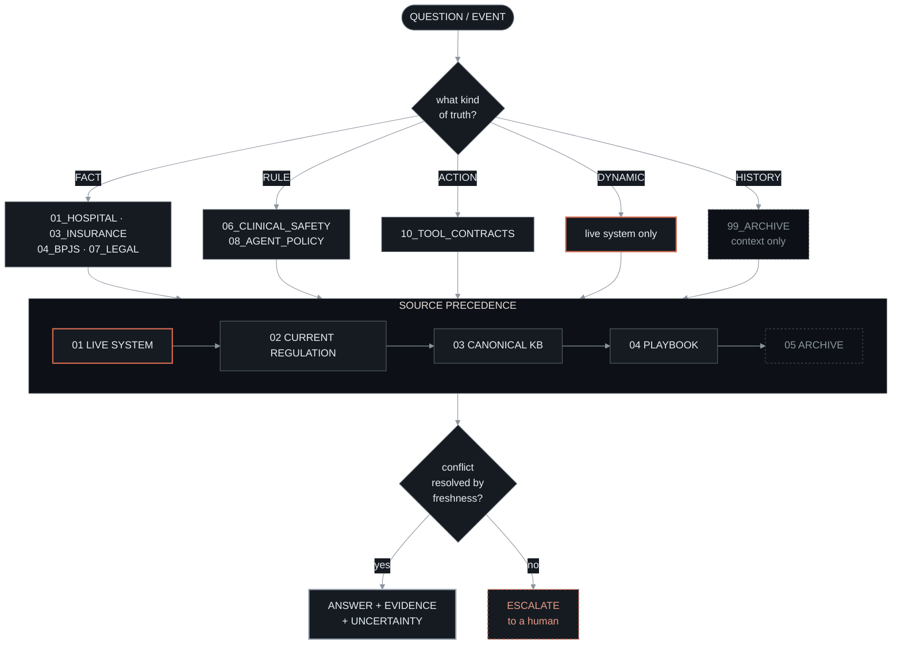

## 04 · Knowledge pipeline

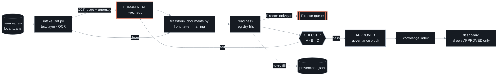

## 05 · Director loop

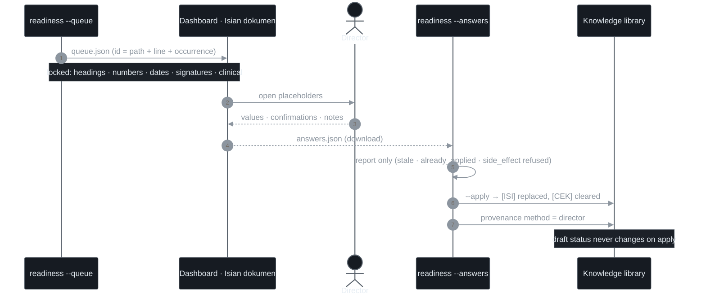

## 06 · Request path

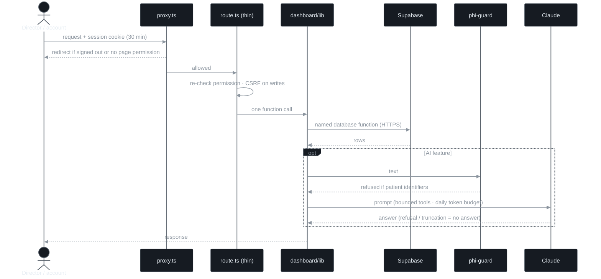

## 07 · Medify feed

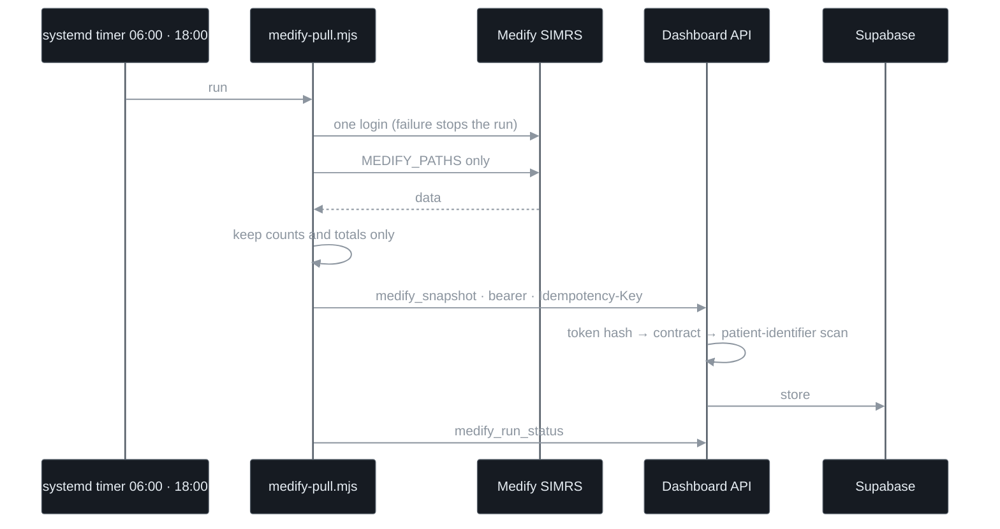

## 08 · Access matrix

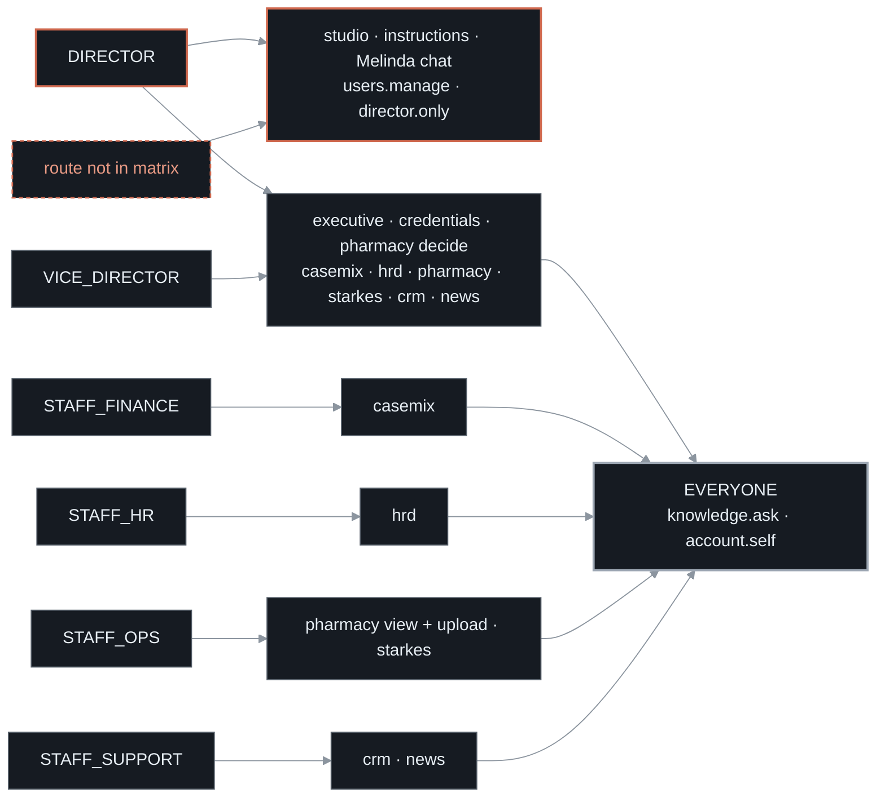

<sub>Source: <code>dashboard/lib/access/access-control.ts</code>. Accounts use scrypt hashes, their own session and CSRF token, and a forced password change after creation or reset.</sub>

## 09 · Runtime


| MCP server | Code | Transport | Tools |
|---|---|---|---|
| Dashboard MCP | `dashboard/app/api/mcp/` | HTTP at `/api/mcp`, bearer token in protected mode | 17 on live dashboard data, 6 of them write |
| Agent MCP | `runtime/src/melinda_agent_mcp/` | stdio (Claude Code via `.mcp.json`) or Streamable HTTP | 9: knowledge, repo files, bridges to the dashboard MCP and MAAF |
| MAAF MCP | `runtime/src/melinda_maaf/mcp_server.py` | Streamable HTTP at `/mcp` | 13 hospital tools behind the gates above |

<sub>Every MCP caller runs as one shared identity, <code>ALL_ACCESS</code>, the only actor MAAF recognizes; the agent roster was removed on 2026-11-20. No backend is configured, so nothing reaches a hospital system. All-access mode skips the L4 and L5 human gates. The REST agent gateway and the bot webhook stay removed (2026-11-12). Setup: <a href="./docs/guides/mcp-install-prompt.md">MCP install prompts</a>.</sub>

## 10 · Authority

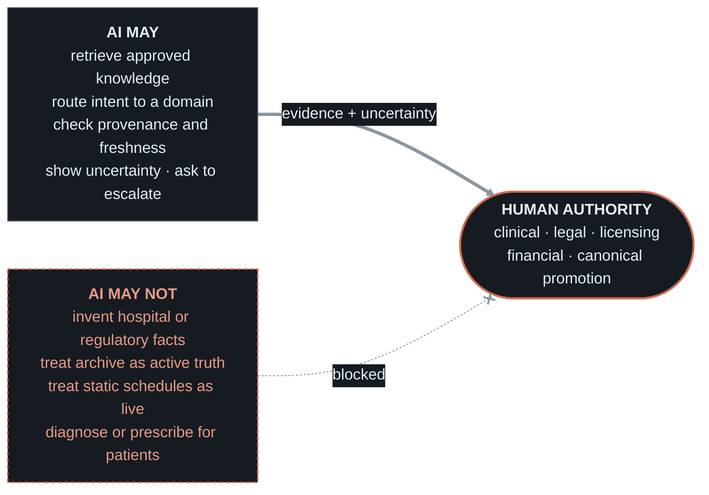

> [!CAUTION]
> **Clinical output is decision support, never clinical authority.** Emergency and high-risk signals follow the safety and escalation rules in `knowledge/06_CLINICAL_SAFETY` and stay under review by a qualified professional.

## 11 · Knowledge domains

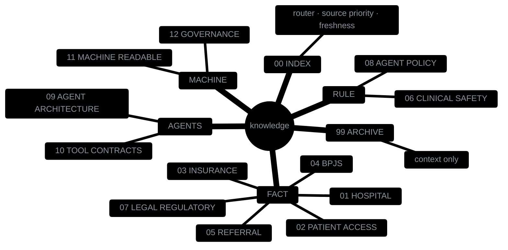

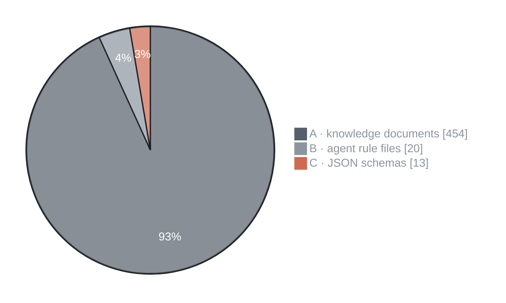

<sub>Checker scope on 2026-11-12: 487 documents, all passing.</sub>

## 12 · Verify

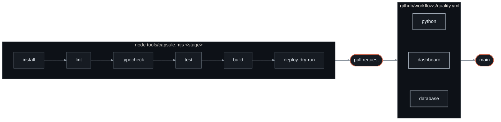

```bash
node tools/capsule.mjs install                           # uv sync + npm ci · Python 3.12, Node 24
node tools/capsule.mjs test                              # pytest + vitest
uv run --locked python -X utf8 tools/governance/validate_frontmatter.py   # document checker
```

<sub>Setup, variables and the full stage list: <a href="./docs/engineering/DEVELOPMENT.md">DEVELOPMENT</a> · <a href="./docs/engineering/TESTING.md">TESTING</a> · <a href="./docs/engineering/VERIFICATION.md">VERIFICATION</a>. Never re-run the legacy extraction scripts; see <a href="./CONTRIBUTING.md">CONTRIBUTING</a>.</sub>

## 13 · Timeline

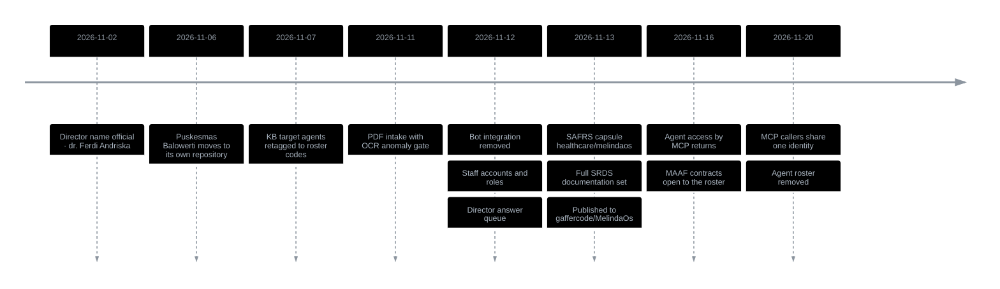

## 14 · Index

| Orient | Build and run | Operate | Govern |
|---|---|---|---|
| [AGENTS](./AGENTS.md) | [ARCHITECTURE](./docs/architecture/ARCHITECTURE.md) | [DEPLOYMENT](./docs/operations/DEPLOYMENT.md) | [SECURITY](./SECURITY.md) |
| [Master Index](./knowledge/00_INDEX/MASTER_INDEX.md) | [DEVELOPMENT](./docs/engineering/DEVELOPMENT.md) | [RUNBOOK](./docs/operations/RUNBOOK.md) | [BOUNDARIES](./docs/governance/BOUNDARIES.md) |
| [Knowledge Router](./knowledge/00_INDEX/KNOWLEDGE_ROUTER.md) | [TESTING](./docs/engineering/TESTING.md) | [TROUBLESHOOTING](./docs/operations/TROUBLESHOOTING.md) | [REGULATORY SAFETY](./docs/security/REGULATORY_SAFETY.md) |
| [Source Priority](./knowledge/00_INDEX/SOURCE_PRIORITY.md) | [DATA](./docs/data/DATA.md) | [OBSERVABILITY](./docs/operations/OBSERVABILITY.md) | [DECISIONS](./docs/architecture/DECISIONS.md) |
| [PRODUCT SCOPE](./docs/product/PRODUCT_SCOPE.md) | [INTEGRATIONS](./docs/integrations/INTEGRATIONS.md) | [Dashboard](./dashboard/README.md) | [CONTRIBUTING](./CONTRIBUTING.md) · [CHANGELOG](./CHANGELOG.md) |

> [!IMPORTANT]
> **Public source, private data.** This repository holds code only: no patient or staff data, no hospital documents, no secrets, no `.env` contents. Report security issues as [SECURITY.md](./SECURITY.md) says, never in a public issue. **Proprietary · RSIA Melinda DHAI.**

## Team

| | dr Ferdi Andriska (The Gaffer) | dr Novia Dwi Anggraini | Joseph Arianto |
|---|:---:|:---:|:---:|
| **Role** | `Architect` | `Co-Architect` | `Liaison Officer` |
| **Focus** | architecture · authority design · product direction | institutional translation · domain alignment | stakeholders · implementation · technology representation |

<p align="center">
  <a href="https://ferdiiskandar.com" title="Website"></a>&nbsp;
  <a href="https://medium.com/@drferdiiskandar" title="Medium"></a>&nbsp;
  <a href="https://orcid.org/my-orcid?orcid=0009-0003-3788-1307" title="ORCID"></a>&nbsp;
  <a href="https://x.com/drferdiiskandar" title="X"></a>&nbsp;
  <a href="https://substack.com/@drferdiiskandar" title="Substack"></a>&nbsp;
  <a href="https://kaggle.com/drferdiiskandar" title="Kaggle"></a>&nbsp;
  <a href="https://reddit.com/user/SixCupaCoffee" title="Reddit"></a>&nbsp;
  <a href="https://linkedin.com/in/dr-ferdi-iskandar-1b620a3b5" title="LinkedIn"></a>&nbsp;
  <a href="https://huggingface.co/dr-Ferdi" title="Hugging Face"></a>&nbsp;
  <a href="https://www.tiktok.com/@ferdiiskandar.md" title="TikTok"></a>&nbsp;
  <a href="https://www.instagram.com/drferdiiskandar" title="Instagram"></a>&nbsp;
  <a href="https://www.threads.com/@drferdiiskandar" title="Threads"></a>
</p>

<p align="center">
  <a href="https://melinda.co.id"></a><br />
  <b>Dedicated to Aldebaran, Aimee, Audrey, and Del — &amp; the Indonesia Healthcare Ecosystem.</b><br />
  <sub>Sentra Artificial Intelligence · Indonesia · <code>// knowledge is static only until reality changes</code></sub>
</p>
